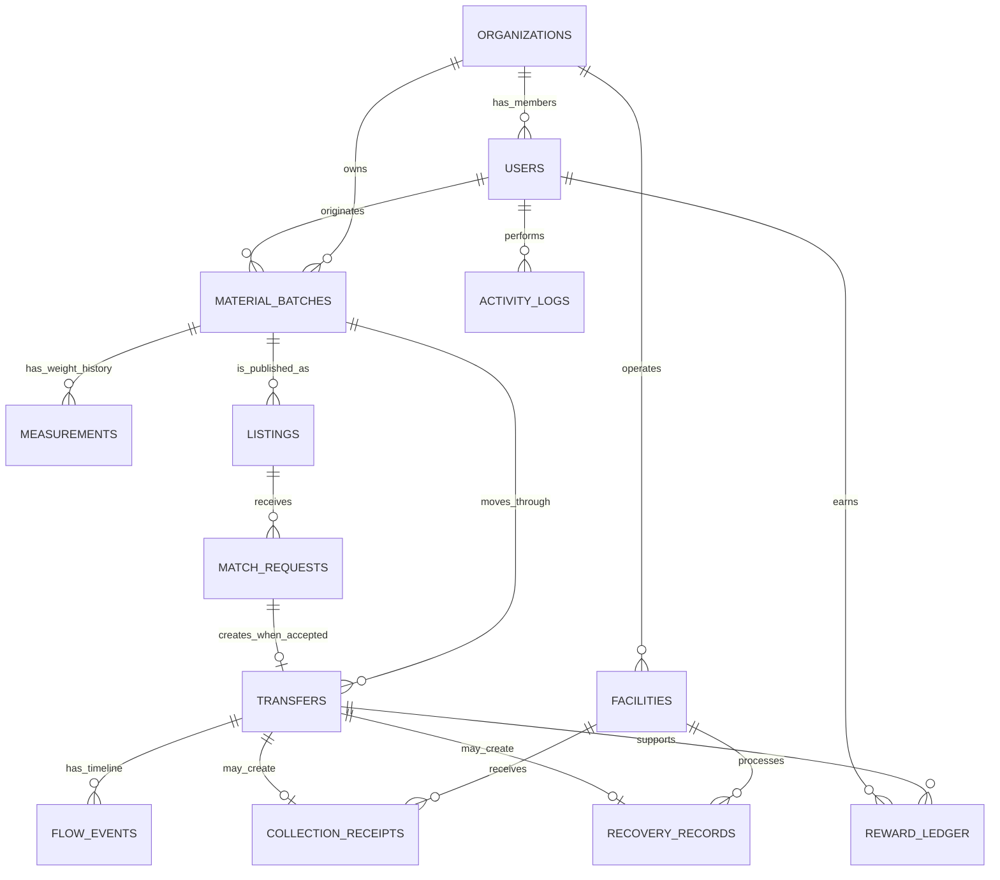

# BalikTelaPH Shared Database Schema v1.0.3

> Superseded for active development by the [Supabase/PostgreSQL migration baseline](Supabase_Migration.md). Retained as the MongoDB source contract used to generate and verify the relational migration.

Status: Final implementation baseline for web/mobile backend integration  
Approved date: 2026-10-06  
Database: MongoDB Community for local development; MongoDB Atlas for shared development and deployment

## Authority and scope

This contract reconciles the finalized BalikTelaPH Web and Mobile Blueprint, the mobile SQLite v7 schema, the mobile MongoDB collection-header export, and the implemented web dashboard model.

It is the authoritative persistence contract for new backend work. API responses and frontend TypeScript objects may use camelCase, but the database names, types, validation rules, and relationships are defined here and in `server/database/schema.ts`.

Version 1.0.3 clarifies that a transfer may have multiple ordered recovery-stage records, adds approved compatibility snapshots used by the web and mobile API adapters, safely indexes only present string usernames, and preserves explicit demo labels through persistence.

The executable, language-neutral contract is `docs/BalikTela_Database_Schema_v1.json`.

## Final design decisions

1. **Material-first model:** `material_batches` is the authoritative textile identity. A Material Batch is not a retail product.
2. **Shared records:** web and mobile use the same users, organizations, batches, measurements, listings, transfer, collection, recovery, and audit records through a shared backend API.
3. **String identifiers:** MongoDB `_id` and all reference fields use non-empty strings. This supports existing web IDs, mobile SQLite IDs, offline creation, and idempotent synchronization without client-side `ObjectId` coupling.
4. **Database naming:** collection and persistence fields use snake_case. The existing mobile `passwordHash` field is retained as a security-sensitive compatibility exception.
5. **Dates:** all database timestamps are BSON `Date`, never display-formatted strings.
6. **Mass:** kilograms are the primary analytical unit. Secondary quantities remain separate and are never converted without an approved methodology.
7. **Weight provenance:** all measurements state `Estimated`, `Measured`, or `Verified`, the stage, method, recorder, time, and optional verifier.
8. **Immutable history:** a later measurement never overwrites an earlier measurement. `material_batches.current_weight_kg` is only the latest operational snapshot.
9. **Transfer lifecycle:** an accepted `match_requests` record creates one `transfers` record. `flow_events` and `measurements` preserve chronological stage history.
10. **No double counting:** official outcome analytics include only validated, non-excluded records and one compatible final outcome per processed mass.
11. **Rewards are not money:** `reward_ledger.points` are integer, non-cash program points. `wallet_accounts` is a cache; the ledger is authoritative.
12. **Audit source:** `activity_logs` is the single audit trail. Sensitive mutations must write an activity record.
13. **Methodology gates:** environmental, predictive, and prescriptive outputs remain disabled until an approved `methodologies` record exists.
14. **Privacy:** government access is aggregate by default; research access is de-identified by default; operational organizations are scoped to their organization/facilities.
15. **No direct client database access:** web and mobile clients call the backend API. Atlas credentials exist only in backend environments.

## Collection inventory

### Identity and governance

| Collection | Purpose | Principal relationships |
| --- | --- | --- |
| `schema_versions` | Applied contract version | Database metadata |
| `users` | Identity, role, profile, consent state, and access scope | Organization and facilities |
| `organizations` | Institutional stakeholders | Users, facilities, batches |
| `sessions` | Revocable hashed authentication sessions | User |
| `consent_history` | Immutable privacy/research consent changes | User and recording actor |
| `activity_logs` | Canonical immutable audit trail | Polymorphic entity target |
| `configurations` | Versioned taxonomies and operational parameters | Updating administrator |

### Material and exchange

| Collection | Purpose | Principal relationships |
| --- | --- | --- |
| `material_batches` | Authoritative material identity and current snapshot | Source user/organization and custodian |
| `measurements` | Immutable kg history and provenance | Batch, transfer, facility, event |
| `listings` | Discoverability and availability of a batch | Batch and owner |
| `favorites` | User-saved listings | User and listing |
| `match_requests` | Proposed quantity and transfer terms | Requester and listing |
| `transfers` | Authoritative accepted material movement | Listing, batch, match request, parties |
| `flow_events` | Ordered material-transfer lifecycle | Batch, transfer, actor, measurement |
| `conversations` | Authorized coordination channel | Listing/transfer and participants |
| `messages` | Conversation messages | Conversation and sender |

### Collection and recovery

| Collection | Purpose | Principal relationships |
| --- | --- | --- |
| `facilities` | Approved physical circular-economy locations | Organization |
| `facility_assignments` | User authority at a facility | User and facility |
| `collection_events` | Approved collection/community activities | Facility and approving actor |
| `event_registrations` | Event participation state | Event and user |
| `collection_receipts` | Permanent facility receipt and measured mass | Transfer, batch, facility, measurement |
| `recovery_records` | Input/output/rejection/loss mass balance | Transfer, batch, facility, organization |

### Engagement, quality, and research

| Collection | Purpose | Principal relationships |
| --- | --- | --- |
| `notifications` | User alerts | User and optional target entity |
| `reward_rules` | Approved versioned point rules | Creator/approver |
| `reward_ledger` | Immutable non-cash point ledger | User, transfer, rule |
| `wallet_accounts` | Cached point balance | User |
| `reports` | User-submitted moderation/safety reports | Reporter and target entity |
| `support_tickets` | Support, feedback, privacy, and UAT submissions | User and assignee |
| `data_quality_issues` | Validation/reconciliation review workflow | Target entity and reviewers |
| `system_interactions` | Approved privacy-scoped engagement instrumentation | User, organization, session |
| `methodologies` | Approval gate and definition for analytical methods | Approver |
| `model_runs` | Model execution provenance and results | Methodology and creator |
| `report_exports` | Audited dataset/report exports | Requesting user |

## Core relationship diagram



## Material-flow rules

The normal lifecycle is:

```text
recorded -> listed -> reserved -> handed over -> collected/received
         -> processing -> reused/upcycled/recycled/recovered -> completed
```

- `material_batches.current_status` is the current projection.
- `flow_events` is the chronological source for stage transitions.
- `measurements` is the chronological source for mass and weight status.
- `collection_receipts` establishes a facility receipt and must reference a measured or verified measurement.
- `recovery_records` must satisfy `input_kg >= output_kg + rejected_kg + loss_kg`, subject to an approved tolerance.
- Receiving a batch does not count it as recycled.
- A transfer is not completed by offer acceptance alone.
- A disputed, cancelled, rejected, flagged, or excluded record does not contribute to official outcome KPIs.

## Identifier and reference rules

- `_id` is a string generated by the backend or an approved offline-safe client strategy.
- Every reference field stores the exact target `_id` string.
- APIs expose `_id` as `id` when required by existing frontend DTOs.
- Database validators do not enforce foreign keys; services must validate references and execute related writes transactionally where supported.
- Idempotency keys are required for reward issuance and should be added to synchronization commands that may be retried.

## Naming and compatibility

| Current web collection | Canonical collection |
| --- | --- |
| `materialBatches` | `material_batches` |
| `offers` | `match_requests` |
| `recoveryRecords` | `recovery_records` |
| `walletEntries` | `reward_ledger` |
| `auditRecords` | `activity_logs` |
| `configurations` | `configurations` |

The persistence adapter must map current camelCase API records to canonical persistence fields. Frontend components must not query MongoDB directly.

Mobile compatibility changes required:

- Split material identity from marketplace availability: `material_batches` plus `listings`.
- Use `participant_ids` instead of `buyer_id`/`owner_id` in conversations.
- Use `match_requests` as the canonical offer/proposal record.
- Store `flow_events` and `measurements` as separate immutable records.
- Use native arrays/objects instead of `looking_for`, `media_json`, or `details_json` JSON strings.
- Configure Mongoose timestamps to snake_case and either disable `__v` or keep it strictly as persistence metadata.

## Legacy collection disposition

| Collection | Decision |
| --- | --- |
| `offers` | Migrate to `match_requests`; do not use for new writes |
| `transactions` | Replace with `transfers` for material movement and `reward_ledger` for points |
| `settings` | Replace with typed, versioned `configurations` |
| `auditlogs` | Merge into `activity_logs` |
| `products` | Excluded from the material-first core schema |
| `orders` | Excluded; conventional retail checkout is outside the blueprint |
| `inventorymovements` | Excluded; use batches, measurements, transfers, and flow events |

Legacy collections should be archived after migration verification, not silently deleted.

## Index and validation policy

The executable schema defines:

- Unique email and optional username.
- One accepted transfer per match request.
- One ordered event sequence per transfer.
- One collection receipt per transfer and multiple time-ordered recovery-stage records where processing requires them.
- Geospatial `2dsphere` facility lookup.
- Time, geography, category, pathway, validation, and organization indexes for dashboard filters.
- TTL deletion for expired server sessions.
- Idempotent reward-ledger entries.
- Strict MongoDB `$jsonSchema` validation with `validationAction: error`.

## Deployment and migration procedure

1. Back up the source database.
2. Apply this schema first to a new development database, not directly over legacy collections.
3. Transform legacy documents into canonical records with a versioned migration script.
4. Validate record counts, reference integrity, mass balance, and authentication.
5. Point the shared backend to the new database.
6. Run web and mobile integration tests.
7. Keep the prior database read-only until acceptance is complete.
8. Apply the schema to Atlas only through an authorized backend environment.

Schema inspection:

```bash
npm run db:schema:check
```

Intentional schema application requires both the command and an environment guard:

```bash
MONGODB_SCHEMA_APPLY=true npm run db:schema:apply
```

Do not enable `MONGODB_SEED_DEMO` in a production or shared operational database. Demo seeding is opt-in and intended only for disposable development databases.

## Versioning policy

- Patch version: validator/index clarification with no application migration.
- Minor version: backward-compatible optional fields or collections.
- Major version: renamed/removed fields, changed meanings, identifier changes, or required data migration.
- Every applied version is recorded in `schema_versions`.
- Schema changes require an accompanying migration plan, updated JSON contract, and web/mobile compatibility review.
