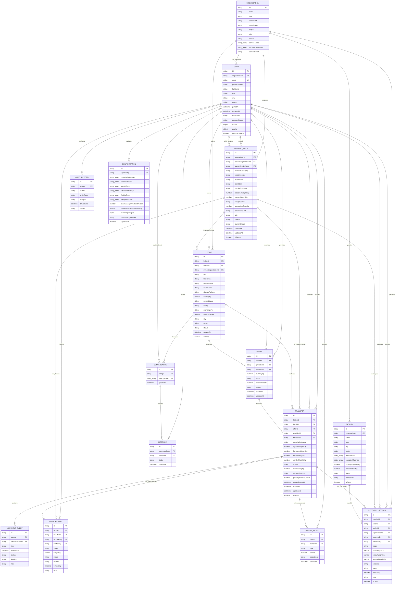
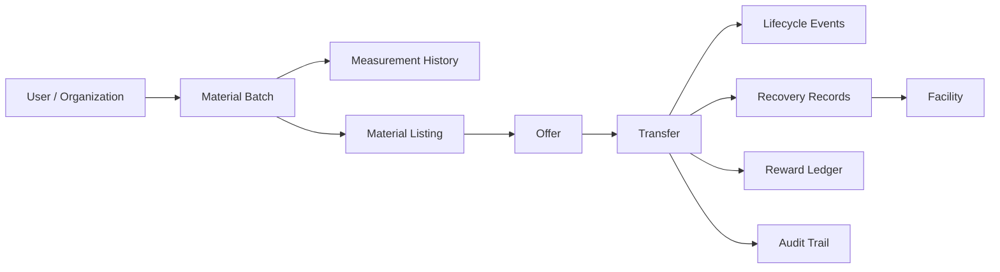

# BalikTela Prototype Entity-Relationship Diagram

> This document describes the current prototype API model. The finalized persistence contract for backend integration is [BalikTelaPH Shared Database Schema v1.0.3](BalikTela_Database_Schema_v1.md).

This ERD reflects the currently implemented server model in `server/types.ts`. The application uses MongoDB when `MONGODB_URI` is configured and an in-memory store for demonstration mode. IDs and relationships are maintained by the application; MongoDB foreign-key constraints are not currently enforced.

## Core ERD

## Embedded Structures

These structures are stored inside their parent records rather than in separate collections:

| Parent | Embedded structure | Important fields |
|---|---|---|
| User | Access scope | `organizationIds`, `facilityIds`, `regions`, `canExport`, `aggregateOnly` |
| User | Profile | age group, organization size, production volume, recycling practices, accepted textiles, sustainability interests |
| Transfer | Lifecycle events | event type, actor, timestamp, status, location, note, optional measurement reference |
| Configuration | Matching weights | category, pathway, region, condition, quantity |

## Relationship Notes

- An organization can have many users and facilities. A user or Material Batch may have no organization when it belongs to an individual participant.
- A Material Batch preserves its originating user and organization separately from its current custodian.
- Measurements form the weight-history record. They always reference a Material Batch and may also reference a transfer stage.
- A listing references one Material Batch. The model permits historical listings for the same batch because uniqueness is not currently enforced.
- An accepted offer can produce one transfer. Rejected, withdrawn, or pending offers do not have a transfer.
- Transfer lifecycle events are embedded in the transfer document, while measurements and recovery records are separate collections.
- Recovery records connect a transfer and Material Batch to the facility and organization performing collection, sorting, processing, recovery, or rejection.
- Conversations store participant IDs as an array, representing a many-to-many relationship between users and conversations.
- Audit targets are polymorphic: `entityType` and `entityId` may refer to users, organizations, batches, transfers, recovery records, configuration, or other audited records.
- Wallet entries are non-cash reward ledger entries. A transfer reference is optional for manual adjustments or future redemptions.

## Main Material-Flow Path

## Current Persistence Notes

- Production-style persistence is available through MongoDB when `MONGODB_URI` is present.
- Without MongoDB configuration, the server starts with a coherent in-memory demonstration dataset.
- Application IDs such as `USR-*`, `MB-*`, and `TRF-*` are the current primary identifiers.
- Fields ending in `Id` represent logical references, but referential integrity and cascade behavior are currently handled by application code.
